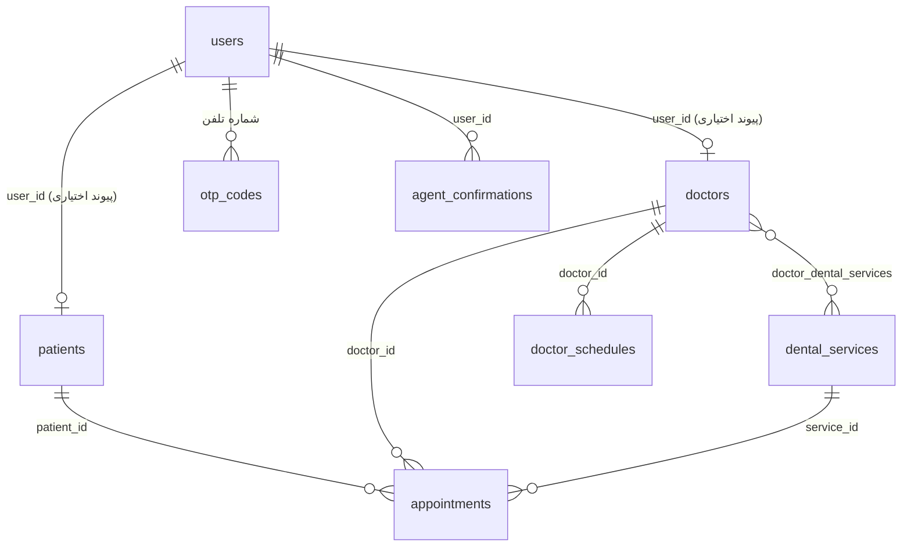

# ۴. نمودار ERD (متناسب با مدل‌های واقعی)

## نمودار

## جدول‌های اصلی

| جدول | ستون‌های کلیدی | نکته‌های طراحی |
|---|---|---|
| `users` | `id`, `full_name`, `phone` (unique), `role`, `password_hash`, `is_active` | رمز به‌صورت Argon2id؛ نقش محدود به ۴ مقدار |
| `patients` | `id`, `national_id` (unique), `full_name`, `phone`, `user_id` | پیوند یک‌به‌یک اختیاری با حساب بیمار؛ unique index روی `user_id` |
| `doctors` | `id`, `full_name`, `specialty`, `phone`, `is_active`, `user_id` | پیوند اختیاری با حساب پزشک؛ تلفن فقط برای admin در رابط کاربری |
| `doctor_schedules` | `doctor_id`, `day_of_week` (شنبه=۰), `start_time`, `end_time`, `slot_duration_minutes`, `is_active` | slotها گسسته و بر پایه فاصله زمانی شروع |
| `dental_services` | `id`, `name`, `description`, `is_active` | کاتالوگ خدمات |
| `doctor_dental_services` | `doctor_id`, `dental_service_id` | جدول رابط چندبه‌چند |
| `appointments` | `id`, `patient_id`, `doctor_id`, `service_id`, `appointment_time` (UTC-like naive), `status`, `reason` | index جزئی یکتا `(doctor_id, appointment_time) WHERE status='scheduled'`؛ تاریخ نهایی شمسی نمایش داده می‌شود |
| `otp_codes` | `phone`, `code_hash` (HMAC), `attempts`, `expires_at`, `consumed_at` | کد واقعی هرگز ذخیره نمی‌شود |
| `agent_confirmations` | `token_hash` (HMAC), `user_id`, `session_id`, `tool_name`, `arguments`, `tool_call_id`, `consumed_at` | تأییدیه یک‌بارمصرف |

## ملاحظات

- همه کلاینت داده‌های SQLite با `SQLAlchemy 2.x` (async) کار می‌کنند.
- زمان نوبت به‌صورت naive در Asia/Tehran نگهداری و مقایسه می‌شود (`clinic_now`).
- مهاجرت‌ها افزایشی و idempotent هستند؛ وجود داده تکراری سیست را مگر با خطا صریح و بدون تغییر داده، اجرای برنامه را متوقف می‌کند.
